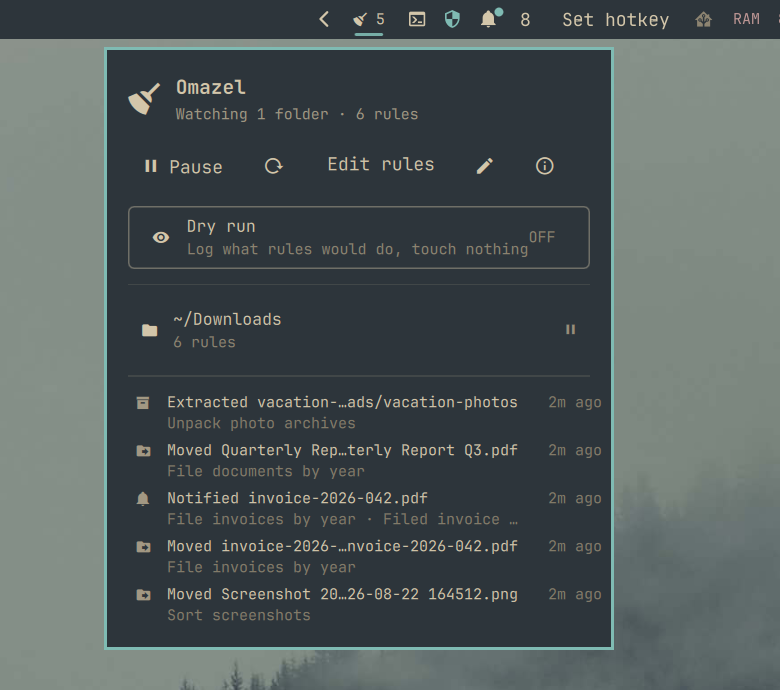
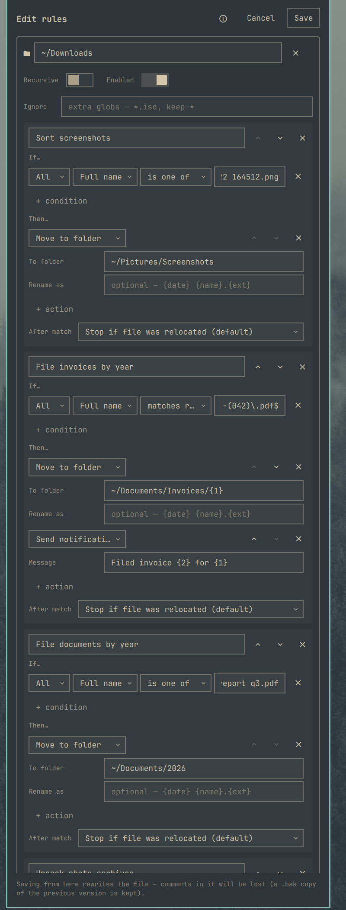

# Omazel

**Hazel for [Omarchy](https://omarchy.org).** Omazel watches folders and acts
on the files that land in them — sorting downloads, filing documents,
expiring old clutter, unpacking archives, encrypting drop folders, and
shipping files to your phone or cloud — driven by rules that run quietly in
the background while a bar widget shows what happened.

If you have used [Hazel](https://www.noodlesoft.com/) on macOS, this is that
workflow for your Omarchy desktop.

**Listed on the [Omarchy Plugin Marketplace](https://omarchyplugins.com/plugin.html?id=io.github.bscott.omazel)** (approved and verified).



## Features

- **Watch any folders** — instant reaction to new files via inotify, plus a
  periodic sweep that fires age-based rules and catches files that arrived
  while the shell was off.
- **Two ways to write rules** — a built-in **visual editor** in the widget
  popup (folders, conditions, and actions from dropdowns, validated before
  saving), or plain TOML in `~/.config/omazel/rules.toml` with your own
  editor. Both round-trip; either way, edits apply on save.
- **Hazel-grade conditions** — name, extension, kind, size, age, created
  date, path, real **MIME type**, the **URL a file was downloaded from**,
  **file contents** (grep), and arbitrary **script checks** (exit 0 =
  match), combined with `all` / `any` / `none` groups.
- **Regex capture tokens** — a `matches` condition exposes its capture
  groups to every pattern in the rule as `{1}`, `{2}`, … so
  `^Invoice-(\d{4})` can file into `~/Documents/Invoices/{1}`.
- **Rich actions** — move, copy, rename, sort into subfolders, trash,
  delete, open, extract archives, compress, desktop notifications, and run
  arbitrary commands.
- **age encryption** — encrypt files on arrival with
  [age](https://age-encryption.org), with a checksum-verified round trip
  before the plaintext original may be removed (removal is opt-in and
  refuses to run unverified unless you say so explicitly).
- **Cloud handoff** — Taildrop to any tailnet device, Dropbox and Proton
  Drive presets, or any configured rclone remote (S3, Drive, B2, SFTP, …).
- **Safe by default** — collision-safe naming (`report (2).pdf`), hidden
  files and partial downloads never touched, settle delay before judging
  fresh files, per-rule cooldowns, loop protection so rules cannot chew on
  their own output, and a global **dry-run** switch that logs what rules
  *would* do without touching anything.
- **Bar widget** — engine status at a glance, per-folder pause toggles, a
  recent-activity feed, rule-problem and missing-tool warnings, pattern-
  variable hints (ⓘ), a docs shortcut, and one-click plugin updates.
- **Scriptable** — pause, resume, dry-run, reload, and sweep over
  `omarchy-shell` IPC for keybindings.

## Install

```bash
omarchy plugin add https://github.com/bscott/Omazel.git --enable
```

Add the **Omazel** widget to your bar (Omarchy bar settings, category
*System*), click the broom, and either **Build rules visually** or
**Create starter rules** to begin from a commented example file.

`inotify-tools` is the one hard dependency for live watching
(`sudo pacman -S inotify-tools`); everything else is only needed by the
rules you actually write, and the popup warns when something is missing.

## A taste

```toml
[[folder]]
path = "~/Downloads"

  # The classic Hazel showcase: match by real content type, download origin,
  # and text inside the file — file it by the year captured from its name.
  [[folder.rule]]
  name = "File bank statements"
  all = [
    { field = "mime", is = "application/pdf" },
    { field = "source", contains = "mybank.com" },
    { field = "contents", contains = "Account Statement" },
    { field = "name", matches = "statement-(\\d{4})" },
  ]
  actions = [{ do = "move", to = "~/Documents/Bank/{1}" }]

  [[folder.rule]]
  name = "Expire old downloads"
  all = [{ field = "age", gt = "30d" }]
  actions = [{ do = "trash" }]
```

Prefer clicking to typing? The same rules can be built entirely in the
visual editor — open the widget popup and hit **Edit rules**.




## Documentation

- **[How-to guide](docs/HOWTO.md)** — every condition, action, and pattern
  token; the visual editor; encryption safety; how the engine works;
  settings; troubleshooting.
- **[Rule cookbook](docs/EXAMPLES.md)** — ready-to-paste recipes: downloads
  triage, invoice filing with captures, encrypt-and-ship drop folders,
  Taildrop, script-gated rules, catch-alls, and more.

The ⓘ button in the widget and editor links here too.

## Widget

| Input | Action |
|-------|--------|
| Left / right click | Open the popup |
| Middle click | Pause / resume the whole engine |

The popup shows engine status, pause and dry-run toggles, a manual sweep
button, the visual rule editor, a text-editor shortcut, every watched folder
with its own pause toggle, the recent activity feed (including what dry-run
would have done), rule problems, and missing-tool warnings.

## Scripting

```bash
omarchy-shell omazel status     # JSON engine state
omarchy-shell omazel toggle     # pause / resume (also pause, resume)
omarchy-shell omazel dryRunToggle
omarchy-shell omazel sweep      # evaluate everything now
omarchy-shell omazel reload     # re-read the rules file
omarchy-shell omazel show       # open the widget popup
omarchy-shell omazel editor     # open the visual rule editor
```

Example Hyprland binding (`~/.config/hypr/bindings.conf`):

```ini
bindd = SUPER SHIFT, O, Toggle Omazel, exec, omarchy-shell omazel toggle
```

## Development

Install the plugin with `omarchy plugin add` (above), then edit it in place
under `~/.config/omarchy/plugins/io.github.bscott.omazel`. After changes:

```bash
node tests/model.test.js   # rule engine unit tests
omarchy plugin validate ~/.config/omarchy/plugins/io.github.bscott.omazel
omarchy-restart-shell      # reload the shell so the service picks up edits
```

The rule engine (`Model.js`) is pure JS and fully unit-tested; actions are
one shell script invocation each (`scripts/omazel-act.sh`), and everything
Omazel does is appended to `~/.local/state/omazel/activity.log`.

## License

[MIT](LICENSE)
